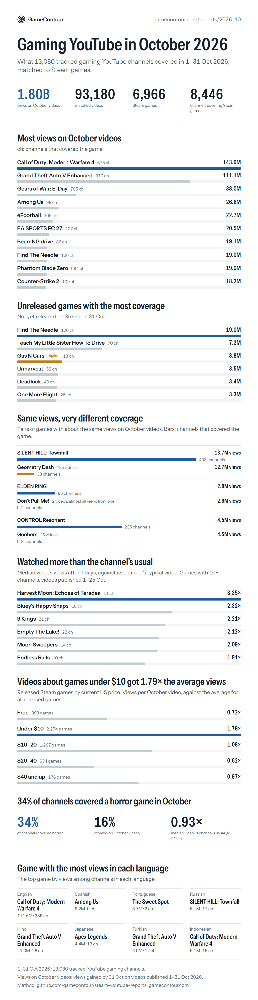

# Steam games on YouTube

Monthly reports from [GameContour](https://gamecontour.com) on which Steam games gaming YouTube covered. Each report matches the videos published by our tracked gaming channels to the Steam games they cover, and shows where views and coverage went that month.

This repository holds the method for each report. The reports themselves, with the full infographic and findings, are on gamecontour.com.

## Reports

| Month | Report | Method |
|---|---|---|
| October 2026 | [gamecontour.com/reports/2026-10](https://gamecontour.com/reports/2026-10?utm_source=github&utm_medium=social&utm_campaign=report-2026-10) | [2026-10/METHOD.md](2026-10/METHOD.md) |

## October 2026 in short

- 13,080 tracked gaming YouTube channels; 8,446 of them covered a Steam game.
- 93,180 videos published 1–31 October were matched to 6,966 Steam games.
- 1.80B views on October videos (views gained by 31 October on videos published in October).

## What these reports measure

Attention on YouTube within our tracked channels: which games got videos, from how many channels, and how many views those videos got. They do not measure sales, wishlists, player counts or all of YouTube. See each month's `METHOD.md` for definitions and caveats.

## Data

The underlying data (per-video views, video and channel identifiers, the matched dataset) is not published. The reports show aggregate findings only.

## Cite as

> GameContour, "Steam games on YouTube · October 2026", gamecontour.com/reports/2026-10, November 2026.

You're welcome to share the cards and quote the findings with a link to the report.

## Contact

Questions about the method, or a game you'd like checked: [gamecontour.com](https://gamecontour.com).
